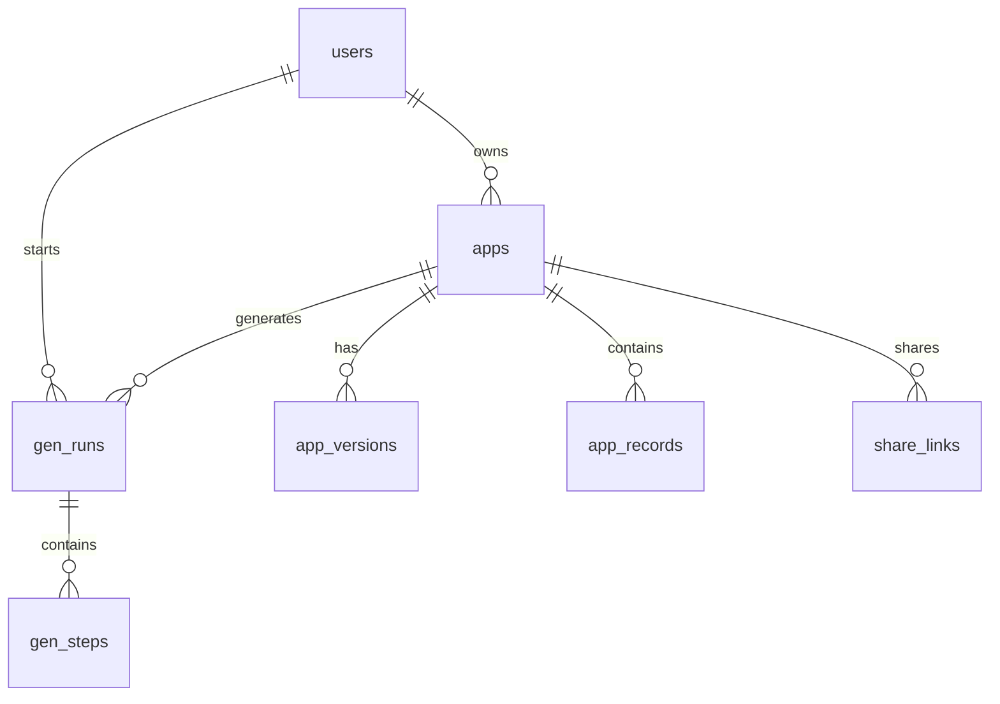

# 08 数据模型与接口设计

> 项目：Atomlet（小原子）｜上游：06 架构 ADR-01（JSONB 统一表）、07 AppSpec 设计
> 本文是后端实现的唯一契约：表结构、DDL、接口、权限、错误码。

## 1. ER 关系说明

7 张表，三组关系。**所有权**：`users → apps`（1:N），`apps.owner_id` 是唯一租户隔离键，所有生成者接口都先过这道过滤。**版本链**：`apps → app_versions`（1:N），`apps.spec` 是"当前生效版本"的物化副本（读优化），`app_versions` 是完整历史（快照 + patch），两者必须在同一事务内更新。**生成与数据**：`apps → app_records`（1:N）承载业务数据、用 `entity` 区分多实体；`apps → gen_runs → gen_steps`（1:N:1:N）记录每一步；`apps → share_links`（1:N）是外部访问凭证。



## 2. 字段定义

| 表 | 字段 | 类型 | 约束 | 说明 |
|---|---|---|---|---|
| **users** | id | uuid | PK, default gen_random_uuid() | 用户主键 |
| | email | text | NOT NULL, UNIQUE | 登录标识；demo 账号固定 `demo@atomlet.local` |
| | display_name | text | NULL | 展示名 |
| | created_at / last_login_at | timestamptz | NOT NULL default now() / NULL | 创建时间 / 末次登录 |
| **apps** | id / owner_id | uuid | PK / NOT NULL, FK→users CASCADE | 应用主键（同时是 `app_records.app_id` 隔离键）/ 唯一租户键 |
| | name / icon / theme | text | NOT NULL, default 'atom'/'neutral' | 从 spec.app 冗余出来，供列表页免解析 JSON |
| | spec | jsonb | NOT NULL | 当前生效 AppSpec（读优化物化副本） |
| | current_version_id / description | uuid/text | NULL / FK→app_versions | 指向当前版本，首次写入后回填 / 一句话描述 |
| | created_at / updated_at | timestamptz | NOT NULL default now() | 列表按 updated_at 排序 |
| **app_versions** | id / app_id | uuid | PK / NOT NULL, FK→apps CASCADE | 版本主键 / 所属应用 |
| | version_no | integer | NOT NULL，UNIQUE(app_id, version_no) | 从 1 递增，回滚时生成新版本号而非复用 |
| | spec / patch | jsonb | NOT NULL / NULL | 该版本完整快照 / 产生它的 RFC 6902 子集（首次生成为 NULL） |
| | change_note / gen_run_id / created_by | text/uuid/uuid | NULL | 变更说明、来源 run、操作者 |
| | created_at | timestamptz | NOT NULL default now() | — |
| **app_records** | id / app_id | uuid | PK / NOT NULL, FK→apps CASCADE | 记录主键（`ref` 字段存的就是它）/ 隔离键 |
| | entity | text | NOT NULL | 对应 `entities[].name` |
| | payload | jsonb | NOT NULL | 业务字段，key = `fields[].name` |
| | source / created_by | text/uuid | NOT NULL default 'owner' / NULL, FK→users SET NULL | `owner`/`public` 审计外部填报；外部填报时 created_by 为空 |
| | created_at / updated_at | timestamptz | NOT NULL default now() | — |
| **share_links** | id / app_id | uuid | PK / NOT NULL, FK→apps CASCADE | 分享链接 |
| | token | text | NOT NULL, UNIQUE | 32 字节随机 base62，只存哈希会无法回显，MVP 明文存 |
| | scope | text | NOT NULL default 'read' | `read` / `write`（CHECK 约束） |
| | entity | text | NULL | write 时限定可写实体；NULL 表示全部 |
| | expires_at / revoked_at | timestamptz | NULL | 过期时间 / 撤销时间，二者任一非空即失效 |
| **gen_runs** | id / app_id / owner_id | uuid | PK / FK→apps CASCADE, NULL / FK→users CASCADE | 生成任务；首次生成时 app 尚未创建故 app_id 可空 |
| | kind / status | text | NOT NULL | `create`/`patch`；`queued`→`running`→`succeeded`/`degraded`/`failed` |
| | provider / model | text | NOT NULL | 如 `deepseek` / `deepseek-chat` |
| | input_text / input_meta | text/jsonb | NULL | 原始需求与列推断，用于复现 |
| | attempt / error | integer/text | NOT NULL default 0 / NULL | 全局重试计数（见 07 文档第 6 节）/ 失败码 |
| | tokens_in / tokens_out / cost_cny | integer/numeric(10,4) | NOT NULL default 0 | 成本核算，与 01 文档成本模型对齐 |
| | latency_ms / finished_at / created_at | integer/timestamptz | NULL / NOT NULL default now() | 端到端耗时与时间戳 |
| **gen_steps** | id / run_id | uuid | PK / FK→gen_runs CASCADE | 逐步骤留痕，支持事后重放与失败定位 |
| | seq | integer | NOT NULL，UNIQUE(run_id, seq) | 保证顺序可重放 |
| | agent / status | text | NOT NULL | `parser`/`planner`/`builder`/`critic`/`repair`；`running`/`ok`/`error` |
| | input / output / issues | jsonb | NULL | 入参、产物、问题单 |
| | prompt_id | text | NULL | 如 `builder@v1`，用于 prompt 版本追溯 |
| | tokens_in / tokens_out / latency_ms | integer | NOT NULL default 0 / NULL | 单步成本与耗时 |
| | created_at | timestamptz | NOT NULL default now() | — |

## 3. 核心 DDL（Postgres 16）

```sql
CREATE EXTENSION IF NOT EXISTS pgcrypto;

-- 1. users
CREATE TABLE users (
  id uuid PRIMARY KEY DEFAULT gen_random_uuid(),
  email text NOT NULL UNIQUE, display_name text,
  created_at timestamptz NOT NULL DEFAULT now(), last_login_at timestamptz
);

-- 2. apps：spec 为「当前生效版本」的物化副本，与 app_versions 同事务更新
CREATE TABLE apps (
  id uuid PRIMARY KEY DEFAULT gen_random_uuid(),
  owner_id uuid NOT NULL REFERENCES users(id) ON DELETE CASCADE,
  name text NOT NULL, icon text NOT NULL DEFAULT 'atom',
  theme text NOT NULL DEFAULT 'neutral', description text,
  spec jsonb NOT NULL, current_version_id uuid,
  created_at timestamptz NOT NULL DEFAULT now(),
  updated_at timestamptz NOT NULL DEFAULT now(),
  CONSTRAINT apps_theme_chk CHECK (theme IN ('neutral','warm','cool'))
);
CREATE INDEX apps_owner_idx ON apps (owner_id, updated_at DESC);

-- 3. app_versions：全量快照 + 产生它的 patch
CREATE TABLE app_versions (
  id uuid PRIMARY KEY DEFAULT gen_random_uuid(),
  app_id uuid NOT NULL REFERENCES apps(id) ON DELETE CASCADE,
  version_no integer NOT NULL, spec jsonb NOT NULL, patch jsonb,
  change_note text, gen_run_id uuid,
  created_by uuid REFERENCES users(id) ON DELETE SET NULL,
  created_at timestamptz NOT NULL DEFAULT now(),
  CONSTRAINT app_versions_uk UNIQUE (app_id, version_no)
);
CREATE INDEX app_versions_app_idx ON app_versions (app_id, version_no DESC);
ALTER TABLE apps ADD CONSTRAINT apps_current_version_fk
  FOREIGN KEY (current_version_id) REFERENCES app_versions(id) ON DELETE SET NULL;

-- 4. app_records：ADR-01 统一表 + JSONB payload，按 app_id 隔离
CREATE TABLE app_records (
  id uuid PRIMARY KEY DEFAULT gen_random_uuid(),
  app_id uuid NOT NULL REFERENCES apps(id) ON DELETE CASCADE,
  entity text NOT NULL, payload jsonb NOT NULL,
  source text NOT NULL DEFAULT 'owner',
  created_by uuid REFERENCES users(id) ON DELETE SET NULL,
  created_at timestamptz NOT NULL DEFAULT now(),
  updated_at timestamptz NOT NULL DEFAULT now(),
  CONSTRAINT app_records_source_chk CHECK (source IN ('owner','public'))
);
CREATE INDEX app_records_app_entity_idx ON app_records (app_id, entity, created_at DESC);
CREATE INDEX app_records_payload_idx ON app_records USING GIN (payload jsonb_path_ops);
-- 唯一字段用表达式索引兜住「先查后写」的并发窗口（示例：门店名唯一）
CREATE UNIQUE INDEX app_records_store_name_uk
  ON app_records (app_id, entity, (payload->>'name')) WHERE entity = 'store';

-- 5. share_links
CREATE TABLE share_links (
  id uuid PRIMARY KEY DEFAULT gen_random_uuid(),
  app_id uuid NOT NULL REFERENCES apps(id) ON DELETE CASCADE,
  token text NOT NULL UNIQUE, scope text NOT NULL DEFAULT 'read', entity text,
  expires_at timestamptz, revoked_at timestamptz,
  created_at timestamptz NOT NULL DEFAULT now(),
  CONSTRAINT share_links_scope_chk CHECK (scope IN ('read','write'))
);
CREATE INDEX share_links_app_idx ON share_links (app_id);

-- 6. gen_runs：一次生成任务
CREATE TABLE gen_runs (
  id uuid PRIMARY KEY DEFAULT gen_random_uuid(),
  app_id uuid REFERENCES apps(id) ON DELETE CASCADE,
  owner_id uuid NOT NULL REFERENCES users(id) ON DELETE CASCADE,
  kind text NOT NULL, status text NOT NULL,
  provider text NOT NULL, model text NOT NULL,
  input_text text, input_meta jsonb,
  attempt integer NOT NULL DEFAULT 0, error text,
  tokens_in integer NOT NULL DEFAULT 0, tokens_out integer NOT NULL DEFAULT 0,
  cost_cny numeric(10,4) NOT NULL DEFAULT 0, latency_ms integer,
  created_at timestamptz NOT NULL DEFAULT now(), finished_at timestamptz,
  CONSTRAINT gen_runs_status_chk
    CHECK (status IN ('queued','running','succeeded','degraded','failed'))
);
CREATE INDEX gen_runs_owner_idx ON gen_runs (owner_id, created_at DESC);
CREATE INDEX gen_runs_app_idx ON gen_runs (app_id, created_at DESC);

-- 7. gen_steps：逐步骤留痕，支持事后重放与失败定位
CREATE TABLE gen_steps (
  id uuid PRIMARY KEY DEFAULT gen_random_uuid(),
  run_id uuid NOT NULL REFERENCES gen_runs(id) ON DELETE CASCADE,
  seq integer NOT NULL, agent text NOT NULL, status text NOT NULL,
  input jsonb, output jsonb, issues jsonb, prompt_id text,
  tokens_in integer NOT NULL DEFAULT 0, tokens_out integer NOT NULL DEFAULT 0,
  latency_ms integer, created_at timestamptz NOT NULL DEFAULT now(),
  CONSTRAINT gen_steps_uk UNIQUE (run_id, seq)
);
CREATE INDEX gen_steps_run_idx ON gen_steps (run_id, seq);
```

> Drizzle 侧要点：`jsonb('payload').$type<Record<string, unknown>>().notNull()`；`timestamp('created_at', { withTimezone: true }).defaultNow().notNull()`；聚合表达式用 `sql` 模板手写（`sql<number>\`count(*) filter (where payload->>'result' = ${v})\``），Drizzle 对此类查询比 Prisma 更直接。

## 4. 接口清单

| 方法 | 路径 | 用途 | 权限 | 流式 |
|---|---|---|---|---|
| POST | `/api/auth/demo` | 固定 demo 账号登录，种 cookie session | 匿名 | 否 |
| POST/GET | `/api/auth/magic` · `/api/auth/callback` | 发送邮箱魔法码 / 校验并建立 session | 匿名 | 否 |
| POST | `/api/parse/table` | CSV/粘贴文本 → 列类型推断（预览用） | 登录 | 否 |
| POST | `/api/apps/generate` | 生成新应用 | 登录 | **是（SSE）** |
| GET | `/api/apps` | 我的应用列表 | 登录 | 否 |
| GET | `/api/apps/:id` | 应用详情（含 spec） | owner | 否 |
| DELETE | `/api/apps/:id` | 删除应用（级联记录与版本） | owner | 否 |
| POST | `/api/apps/:id/chat` | 增量修改 | owner | **是（SSE）** |
| GET | `/api/apps/:id/versions` | 版本列表（含 diff 摘要） | owner | 否 |
| POST | `/api/apps/:id/versions/:vid/rollback` | 回滚到指定版本 | owner | 否 |
| GET | `/api/apps/:id/records` | 记录列表（简易分页） | owner | 否 |
| POST | `/api/apps/:id/records` | 新建记录 | owner | 否 |
| PATCH | `/api/apps/:id/records/:rid` | 更新记录（部分字段） | owner | 否 |
| DELETE | `/api/apps/:id/records/:rid` | 删除记录 | owner | 否 |
| POST | `/api/apps/:id/records/query` | 分页/排序/过滤/聚合（复杂查询走这里） | owner | 否 |
| POST | `/api/apps/:id/share-links` | 创建分享链接 | owner | 否 |
| DELETE | `/api/apps/:id/share-links/:lid` | 撤销分享链接 | owner | 否 |
| GET | `/api/public/:token` | 公开应用元信息 + spec 子集 | token(read) | 否 |
| GET | `/api/public/:token/records` | 公开读记录 | token(read) | 否 |
| POST | `/api/public/:token/records` | 公开填报 | token(write) | 否 |
| GET | `/api/healthz` | 健康检查（含 DB ping） | 匿名 | 否 |

## 5. 关键接口定义

### 5.1 POST /api/apps/generate（SSE）

请求：`{ "requirement": "门店每日巡检", "tableCsv": "门店,巡检项,结果\n望京店,消防通道,合格", "provider": "deepseek" }`（`requirement` 与 `tableCsv` 至少给一个）

响应流（`text/event-stream`，每个事件 `data:` 一行 JSON）：

```
event: step   data: {"agent":"parser","status":"ok","summary":"识别 3 列，2 个枚举字段"}
event: step   data: {"agent":"planner","status":"running"}
event: token  data: {"agent":"builder","delta":"{\"specVersion\":\"1.0\","}
event: done   data: {"appId":"...","versionNo":1,"degraded":false,"runId":"...","latencyMs":24110}
event: error  data: {"code":"GENERATE_FAILED","message":"...","runId":"...","retryable":true}
```

错误：401 `UNAUTHORIZED`｜413 `PAYLOAD_TOO_LARGE`｜422 `PARSE_FAILED`｜429 `RATE_LIMITED`｜502 `GENERATE_FAILED`｜504 `GENERATE_TIMEOUT`

### 5.2 POST /api/apps/:id/chat（增量修改，SSE）

请求：`{ "instruction": "把评分改成必填，并加一个按门店的平均分卡片", "provider": "deepseek" }`

响应流：`event: patch  data: {"patch":[{"op":"replace","path":"/entities/1/fields/3/required","value":true}]}` → `event: done data: {"versionNo":2,"appliedOps":3,"droppedOps":0,"degraded":false}`

`droppedOps > 0` 时附 `event: warn data: {"reason":"path 不存在：/pages/3/cards/2","dropped":["/pages/3/cards/2"]}`。

错误：401 `UNAUTHORIZED`｜403 `FORBIDDEN`｜404 `NOT_FOUND`｜422 `PATCH_OUT_OF_SCOPE`｜422 `SPEC_INVALID`（apply 后校验失败，事务回滚，不产生新版本）

### 5.3 GET /api/apps/:id

响应 `200`：`{"id":"a1b2…","name":"门店巡检","icon":"clipboard-check","theme":"neutral","currentVersion":3,"spec":{"specVersion":"1.0","app":{},"entities":[]},"shareLinks":[{"id":"s1","token":"4f9k…","scope":"write","expiresAt":"2025-11-01T00:00:00Z"}],"recordCounts":{"store":3,"inspection":128},"updatedAt":"2025-10-25T08:12:00Z"}`

> `spec` 直接下发给前端渲染器，不再二次包装；`recordCounts` 用一次 `GROUP BY entity` 聚合查询得到，避免前端逐个实体请求。

错误：401 `UNAUTHORIZED`｜403 `FORBIDDEN`（非 owner）｜404 `NOT_FOUND`

### 5.4 POST /api/public/:token/records

请求：`{ "entity": "inspection", "payload": { "store": "r_88f1", "item": "消防通道", "result": "合格", "inspectedAt": "2025-10-25" } }`

响应 `201`：`{ "id": "r_9c02", "createdAt": "2025-10-25T09:01:22Z" }`

服务端按 token 对应应用的**当前版本 spec** 做字段级校验：未知字段丢弃、必填缺失报错、enum 越界报错、`ref` 校验目标记录存在且属于同一 app、`unique` 字段先查后写。

错误：401 `TOKEN_EXPIRED`（过期/撤销）｜403 `TOKEN_SCOPE_DENIED`（scope=read）｜403 `ENTITY_NOT_ALLOWED`（不在 `sharePolicy.entities`）｜422 `VALIDATION_FAILED`（带 `fieldErrors`）｜429 `RATE_LIMITED`

### 5.5 GET /api/public/:token/records

查询参数：`entity`（必填）、`page`（默认 1）、`pageSize`（默认 20，上限 100）、`sort`（如 `inspectedAt:desc`）、`filter`（如 `result:eq:合格`，可重复）

响应 `200`：`{ "rows": [{ "id": "r_9c02", "payload": { "item": "消防通道" }, "createdAt": "…" }], "page": 1, "pageSize": 20, "total": 128 }`

错误：401 `TOKEN_EXPIRED`｜422 `VALIDATION_FAILED`（sort/filter 字段不在 spec 内，**白名单校验，直接拒绝而非静默忽略**）

### 5.6 POST /api/apps/:id/versions/:vid/rollback

请求：`{ "note": "改坏了，回到 v2" }`；响应 `200`：`{ "versionNo": 4, "rolledBackFrom": 3, "rolledBackTo": 2 }`

语义：**不删除任何历史版本**，把 v2 的 spec 复制为 v4 并更新 `apps.spec` / `apps.current_version_id`。这样"回滚"本身也可回滚。

错误：401 `UNAUTHORIZED`｜403 `FORBIDDEN`｜404 `NOT_FOUND`（vid 不属于该 app）｜409 `CONFLICT`（当前已等于目标版本）

## 6. 鉴权与权限模型

| 主体 | 凭证 | 权限范围 | 有效期 |
|---|---|---|---|
| 生成者 | `atomlet_session` cookie（httpOnly, SameSite=Lax, Secure 视部署） | 自己 `owner_id` 下的全部 apps / versions / records | 7 天，滑动续期 |
| 外部填报者 | URL 中的 `:token` | 单应用、按 `scope` 与 `entity` 限定；不可访问 versions / gen_runs / 其他应用 | 由 `expires_at` 控制，默认 7 天 |

- **demo 账号**：`POST /api/auth/demo` 直接为固定用户建 session，用于演示；生产环境用环境变量 `DEMO_LOGIN_ENABLED=false` 关闭。
- **token 生成**：`crypto.randomBytes(24).toString('base64url')`（32 字符）；不设自增 id，避免枚举。
- **撤销**：写 `revoked_at`，校验时 `expires_at > now() AND revoked_at IS NULL`；撤销立即生效（每次请求查库，不做缓存，因为外部填报 QPS 低）。
- **越权防护**：所有 owner 接口统一走 `requireOwner(appId)`，内部 `SELECT 1 FROM apps WHERE id=$1 AND owner_id=$2`，不依赖前端传 owner_id。
- **明确不做**：RBAC、组织/团队、token 的 scope 细分到字段级。

## 7. 错误码总表

响应体统一形状：`{ "error": { "code": "…", "message": "…", "requestId": "…", "details"?: {} } }`

| code | HTTP | 触发场景 | 前端表现 |
|---|---|---|---|
| `UNAUTHORIZED` | 401 | 无 session / session 过期 | 跳登录 |
| `TOKEN_EXPIRED` | 401 | 分享链接过期或已撤销 | 显示"链接已失效" |
| `FORBIDDEN` | 403 | 非 owner 访问 | 显示无权限 |
| `TOKEN_SCOPE_DENIED` | 403 | read token 尝试写 | 隐藏提交按钮（前端先判） |
| `ENTITY_NOT_ALLOWED` | 403 | 实体不在 sharePolicy 白名单 | 提示不可填报该类型 |
| `NOT_FOUND` | 404 | 资源不存在或已删除 | 空态页 |
| `CONFLICT` | 409 | 回滚到当前版本 / 唯一字段重复 | 行内提示 |
| `PAYLOAD_TOO_LARGE` | 413 | 请求体 > 2 MB | 提示压缩后重试 |
| `PARSE_FAILED` | 422 | 表格无表头或全空 | 引导手工描述需求 |
| `VALIDATION_FAILED` | 422 | 字段级校验失败，`details.fieldErrors` | 表单字段标红 |
| `SPEC_INVALID` | 422 | patch apply 后 spec 校验失败 | 提示"修改未生效，已回滚" |
| `PATCH_OUT_OF_SCOPE` | 422 | patch 路径不在白名单 | 提示重述需求 |
| `RATE_LIMITED` | 429 | 超频（生成 5 次/分/用户） | 倒数后重试 |
| `INTERNAL` | 500 | 未捕获异常 | 通用错误 + requestId |
| `GENERATE_FAILED` | 502 | 模型调用失败 | 重试按钮 |
| `GENERATE_TIMEOUT` | 504 | run 超 90s | 提示已降级/重试 |

## 8. 分页 / 排序 / 聚合参数约定

| 参数 | 格式 | 默认 | 校验 |
|---|---|---|---|
| `page` | 整数 ≥ 1 | 1 | 越界返回空数组而非报错 |
| `pageSize` | 整数 1–100 | 20 | 超上限截断为 100 |
| `sort` | `field:asc\|desc`，多字段逗号分隔 | `createdAt:desc` | `field` 必须在 spec 该 entity 的字段内（防 JSONB 任意路径） |
| `filter` | `field:op:value`，op ∈ `eq neq contains gt gte lt lte` | 无 | 同上白名单；`contains` 只允许 `text`/`longtext`/`enum` |
| `aggregate` | `POST /records/query` 的 body 字段 | 无 | 见下 |

```json
{ "entity": "inspection", "page": 1, "pageSize": 20, "sort": "inspectedAt:desc",
  "filters": [{ "field": "result", "op": "eq", "value": "不合格" }],
  "aggregate": [{ "fn": "avg", "field": "score", "groupBy": "store" }, { "fn": "count" }],
  "dateBucket": { "field": "inspectedAt", "unit": "day", "from": "2025-10-01", "to": "2025-10-31" } }
```

服务端拼 SQL 用 `payload->>'field'`，字段名必须先过白名单再拼（**不允许把用户输入的字段名直接插进 SQL 字符串**）；`eq` 对 enum/text 用文本比较，对 number/date 用 `::numeric` / `::date` 转换。`dateBucket` 用 `date_trunc($unit, (payload->>'field')::timestamptz)`。

## 9. 实现代价估算

| 项 | 内容 | 工时 |
|---|---|---|
| schema.ts（7 表 Drizzle 定义） | 表、索引、CHECK、类型导出 | 0.2h |
| `queries/apps.ts` | 列表、详情、创建（事务：apps + version v1 + 回填 current_version_id） | 0.15h |
| `queries/records.ts` | 字段级校验（9 种类型）+ CRUD + 分页/排序/过滤/聚合 | 0.3h |
| `queries/runs.ts` | run/step 写入与状态流转 | 0.1h |
| auth（demo session + share token） | cookie、`requireOwner`、token 校验 | 0.15h |
| 公开接口（3 个）+ 版本与回滚 | token 鉴权 + 复用 records 校验逻辑；版本列表 + rollback 事务 | 0.3h |
| 错误码与 requestId 中间件 | 统一响应形状 | 0.1h |
| **小计** | | **1.3h** |

> 与 01 文档对应：任务 5（数据层 0.7h）+ 任务 1 中的 DB 连线（0.2h）+ 任务 6 中的版本落地（0.2h）+ 任务 8 中的 share token（0.2h）= 1.3h，未超出 P0/P1 预算。
